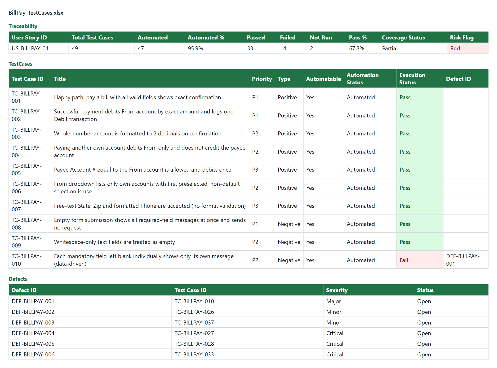
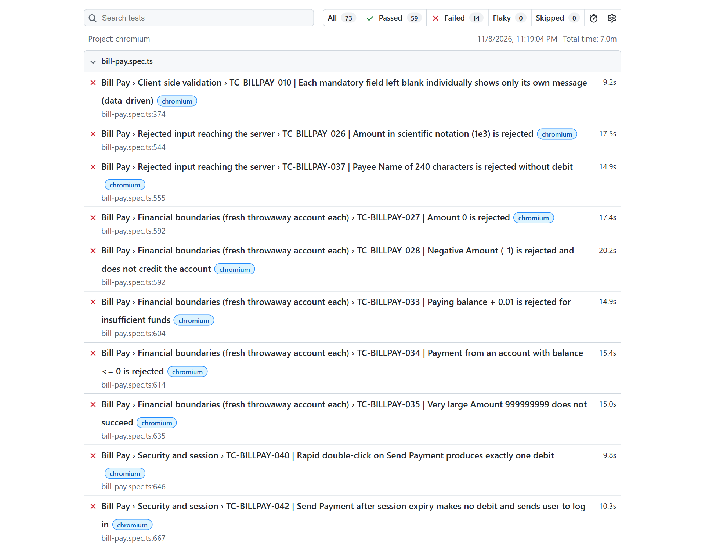
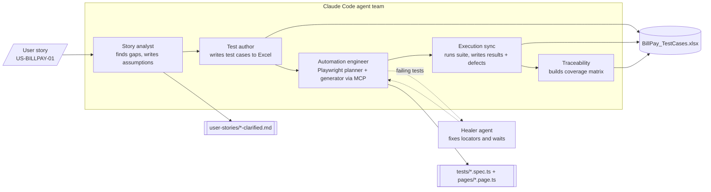

# Agentic QA for ParaBank

**From a one-paragraph user story to an executed Playwright suite and an Excel traceability matrix, driven by a team of Claude Code agents.**


I built this while learning Claude Code. It is a QA framework, not an app: a set of **9 agents, 3 skills and 2 slash commands** that do the work a QA team does on a banking feature. The system under test is [ParaBank](https://github.com/parasoft/parabank), Parasoft's open-source demo bank.

## Results on one user story

The pipeline was given one story, **US-BILLPAY-01** ("As a customer I want to pay a bill from my account…"), with two acceptance criteria. Without further input it produced:

| | |
|---|---|
| Ambiguities found in the story | **18**, each with a documented assumption flagged for PO sign-off |
| Test cases written | **49** (positive, negative, boundary, security, session) |
| Automated | **47** (95.9%), with page objects and data-driven specs |
| Executed | **33 pass, 14 fail** |
| Defects logged | **14**, including 7 critical |
| Traceability | every acceptance criterion and every ambiguity maps to at least one test |

Some of the real ParaBank defects it found:

- **Amount `0` and negative amounts are accepted** (`DEF-BILLPAY-004`, `-005`)
- **Overdraft:** paying balance + 0.01 goes through (`DEF-BILLPAY-006`)
- **Double-click on Send Payment debits twice** (`DEF-BILLPAY-009`)
- **Stored XSS** through Payee Name in Account Activity (`DEF-BILLPAY-011`)
- **The bill-pay API accepts a From account owned by another customer** (`DEF-BILLPAY-014`)



A fresh Chromium run of the whole suite (Bill Pay plus Transfer Funds) gives **73 tests: 59 pass, and 14 fail**. The 14 failures are exactly the logged defects. The tests check what a bank *should* do, so they stay red until ParaBank is fixed.



## How it works



Each teammate is spawned only once the step it depends on is finished, so no agent sits idle using tokens. The spreadsheet has **strict column ownership**: [`utils/excel-helper.js`](utils/excel-helper.js) only lets each role write its own columns, so agents can't overwrite each other's work.

## What's in the repo

### Agents ([`.claude/agents/`](.claude/agents))

| Agent | What it does |
|---|---|
| `story-analyst-agent` | Reads a raw story and lists every gap a tester would otherwise guess at, with sourced assumptions |
| `test-author-agent` | Turns the clarified story into structured test cases in the Excel schema |
| `playwright-automation-agent` | Orchestrates the Playwright planner and generator, and applies the banking and automation skills |
| `execution-sync-agent` | Runs the suite and writes real pass/fail results and defects back onto the right Excel rows |
| `traceability-agent` | Builds the requirements traceability matrix with coverage % and a risk flag |
| `qa-analyst-agent` | Senior banking QA persona: risk matrix plus test cases for a single feature |
| `playwright-test-planner` / `-generator` / `-healer` | Official Playwright agents (`npx playwright init-agents --loop=claude`) that explore the live DOM over MCP, write the tests, and fix failing ones |

### Skills ([`.claude/skills/`](.claude/skills))

| Skill | Knowledge it adds |
|---|---|
| `banking-qa-knowledge` | Financial, security and compliance risk categories, boundary values, test case format |
| `playwright-automation-standards` | Locator priority, page objects, waits, test data, assertions |
| `excel-test-management` | One workbook per feature, fixed schemas, per-role column ownership, ID-based linking |

### Commands ([`.claude/commands/`](.claude/commands))

| Command | Use |
|---|---|
| `/design-test <feature>` | Risk-based test design for one feature (agent + skill) |
| `/generate-playwright-tests <feature>` | Full explore → plan → generate → run → heal loop for one feature |

The full agent-team prompt is in [`prompts/04_team-agent-prompt.md`](prompts/04_team-agent-prompt.md).

### Other folders

```
pages/          Page objects: login, accounts, transfer funds, bill pay
tests/          bill-pay.spec.ts, transfer-funds.spec.ts (73 tests incl. data-driven)
test-data/      JSON test data per feature
specs/          Test plans written by the Playwright planner agent
user-stories/   Clarified story produced by the story analyst
test-cases/     Excel workbook + JSON sources + coverage map
test/           Transfer Funds test design from /design-test
docs/           ParaBank architecture analysis and functional test scenarios
```

## Plain prompt vs. skills and agents

Early on I asked Claude for Transfer Funds test cases with a plain prompt, then again through `/design-test` with the `banking-qa-knowledge` skill. The difference was in both format and depth. The skill-backed version came back with a ranked risk matrix, boundary values on amounts and balances, fraud, security and concurrency cases, and a coverage check against every policy and risk category. See [`test/transfer-funds-test-design.md`](test/transfer-funds-test-design.md).

Generated tests had a similar problem. Without MCP, Claude **guessed locators** that didn't exist. Connecting the Playwright MCP server let the agents read the real DOM, and the healer agent fixed tests that broke later.

## Run it

You need Node 18+ and a running ParaBank.

**1. Start ParaBank.** Either with Docker:

```bash
docker run -d -p 8080:8080 parasoft/parabank
```

or from source (JDK + Maven + Tomcat), following the [ParaBank README](https://github.com/parasoft/parabank). It should be available at `http://localhost:8080/parabank/`.

**2. Install and run the tests.**

```bash
npm install
npx playwright install chromium
npm test
```

Set `PARABANK_URL`, `PARABANK_USER` and `PARABANK_PASS` to point at another instance or user. The default login is in `test-data/*.json`; register that user on a fresh ParaBank first.

**3. Use the agents.** Open the folder in Claude Code. The Playwright MCP server is configured in [`.mcp.json`](.mcp.json), and agent teams are switched on in [`.claude/settings.json`](.claude/settings.json). Then:

```
/generate-playwright-tests transfer funds
```

> The story analyst reads ParaBank's Java source for evidence. To use it, put this repo's files in the root of a ParaBank checkout.

**Update the workbook from a test run:**

```bash
npx playwright test tests/bill-pay.spec.ts --project=chromium --reporter=json > results.json
npm run tc -- sync BillPay results.json
npm run tc -- trace BillPay
```

## What I learned

- **Skills give the knowledge, agents give the role, commands start the work.** Keeping them apart lets agents share knowledge.
- **MCP is what makes generated tests work.** Without the real DOM, locators are guesses.
- **Agent teams are worth it for work with clear hand-offs,** but they cost far more tokens than subagents. Spawning each teammate only when its input exists keeps the cost down.
- **Shared files need ownership rules.** Per-role column ownership in Excel stopped agents from overwriting each other.
- **ParaBank isn't safe for parallel runs,** because concurrent account creation hits duplicate keys. The suite runs with one worker.

## Credits

[ParaBank](https://github.com/parasoft/parabank) is © Parasoft and licensed under Apache 2.0; it is not included here. The three `playwright-test-*` agents come from Playwright's `init-agents`. Everything else is mine and under the [MIT license](LICENSE).

Part of my Claude Code learning series: see [claude-code-learning-journal](https://github.com/nidhinegi1995/claude-code-learning-journal) and [one-prompt-apps](https://github.com/nidhinegi1995/one-prompt-apps).
